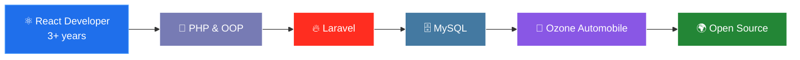

<!-- ===== HEADER ===== -->
<div align="center">


<a href="https://git.io/typing-svg">
  
</a>

<br/><br/>


</div>

---

## 👨‍💻 About Me

```js
const rahat = {
  name: "Minhajul Abedin Rahat",
  location: "Japan 🇯🇵",
  role: "Software Engineer",
  experience: "3+ years of React.js",
  languages: ["Bengali 🇧🇩", "English 🇬🇧", "Japanese 🇯🇵 (learning)"],
  currentlyBuilding: "Ozone Automobile 🚗",
  currentFocus: "Frontend → Full-Stack",
  goals2026: "Contribute more to Open Source 🌍",
  funFact: "I love traveling ✈️ and watching movies 🎬",
};
```

<table>
<tr>
<td width="50%">

### 🔭 Right Now
- 🚗 Building **Ozone Automobile**
- 🌱 Leveling up on the **PHP + Laravel** backend
- 🌍 Working toward **open source** contributions

</td>
<td width="50%">

### 💬 Ask Me About
- ⚛️ React, hooks & frontend architecture
- 🐘 Moving from frontend to full-stack
- 🇯🇵 Developer life in Japan

</td>
</tr>
</table>

---

## 🚀 Currently Learning: The Full-Stack Roadmap

> *"From pixels to databases, one layer at a time."* 🧱

```text
🐘 PHP (OOP)          ▰▰▰▰▰▰▰▱▱▱  70%
🔥 Laravel            ▰▰▰▰▰▰▱▱▱▱  60%
🗄️ MySQL / SQL        ▰▰▰▰▰▰▱▱▱▱  60%
🔌 REST API Design    ▰▰▰▰▰▱▱▱▱▱  50%
🧪 Testing (PHPUnit)  ▰▰▱▱▱▱▱▱▱▱  20%
🐳 Docker             ▰▰▱▱▱▱▱▱▱▱  20%
```

<div align="center">


</div>

### 🗺️ My Journey



---

## 🛠️ Tech Stack

<div align="center">

**🎨 Frontend**


**⚙️ Backend & Database**


**🧰 Tools & DevOps**


</div>

---

## 📊 GitHub Stats

<div align="center">


<br/>


</div>

---

## 🏆 Trophies

<div align="center">


</div>

---

## 📈 Contribution Graph

<div align="center">


</div>

---

## 🎯 2026 Goals

- [x] 🚀 Move from frontend into full-stack development
- [ ] 🚗 Ship **Ozone Automobile**
- [ ] 🌍 Make meaningful open source contributions
- [ ] 🗣️ Keep leveling up my Japanese
- [ ] ✈️ Travel somewhere new

---

## 🤝 Connect With Me

<div align="center">

<a href="https://www.linkedin.com/in/minhajul-abedin-rahat-815286146/">
  
</a>
<a href="https://www.facebook.com/rahat.minhaj">
  
</a>
<a href="https://www.instagram.com/rahat_minhaj007/">
  
</a>

</div>

---

<div align="center">

💬 *Open to collaboration on open source projects. Feel free to reach out!*

⭐ *If you like what you see, drop a star on my repos!* ⭐


</div>
